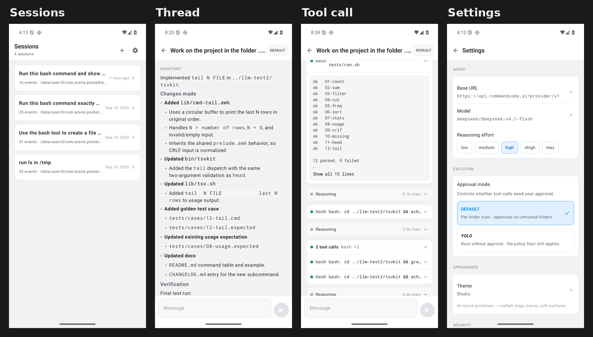
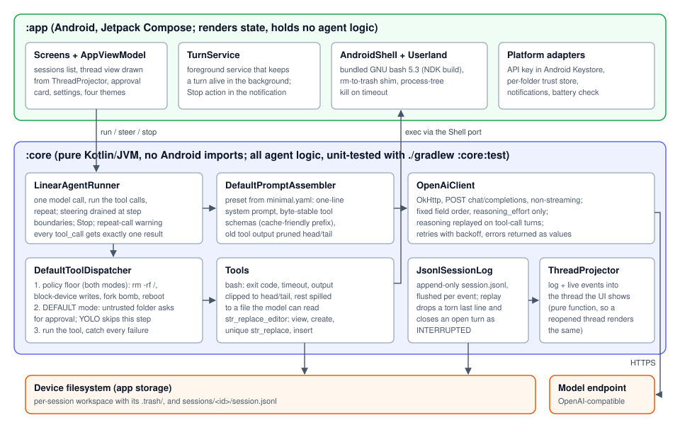
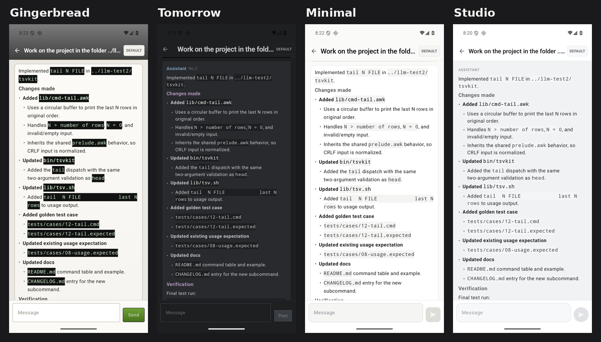

# PocketHarness

[](https://github.com/ArsVie/pocket-harness/actions/workflows/ci.yml)
[](https://github.com/ArsVie/pocket-harness/releases)
[](LICENSE)

**A coding agent that runs on your Android phone.** It sends your request to any OpenAI-compatible
model, runs the model's commands in a real GNU bash on the phone's own filesystem, and keeps every
session as a chat thread you can approve, steer, stop and resume.



## Why it is interesting

Most coding agents assume a laptop or a cloud VM. This one assumes a phone, which forces some
non-obvious engineering:

- **A real shell where Android does not want one.** Android's seccomp filter kills busybox-style
  applets, and since Android 10 apps targeting a modern SDK cannot exec files they wrote themselves.
  The app ships **GNU bash 5.3 cross-compiled for bionic with the NDK**
  ([`scripts/build-bash-android.sh`](scripts/build-bash-android.sh)), unpacks the right ABI at
  startup, self-tests it, and falls back to the platform `sh` if it fails. One configure knob
  (`bash_cv_getcwd_malloc=yes`) is the difference between a working shell and a permission error on
  every command in app storage; [`scripts/getcwd-probe.c`](scripts/getcwd-probe.c) is the on-device
  probe that found it.
- **A deliberately minimal harness.** Two tools (`bash`, `str_replace_editor`), a one-sentence
  system prompt, and a linear loop: call the model, run its tool calls in order, repeat. What the
  model needs to know about the phone (no package manager, toybox gaps, `$TMPDIR`, the network) lives
  in the [`bash` tool description](core/src/main/kotlin/ph/tools/ToolSchemas.kt), not in the prompt.
- **Cache-friendly by construction.** Tool schemas are byte-stable and the request body is built in a
  fixed field order, so the prompt prefix does not change between turns and providers can reuse
  their prompt cache.
- **The transcript is the durable object.** Every model call and tool result is appended to a
  `session.jsonl` and flushed before it is used. Reopening a thread replays the log: a torn last line
  is dropped, an unfinished turn is closed as `INTERRUPTED`, and a tool call is never left without a
  result (providers reject a conversation with a dangling `tool_call`).
- **Safety that a mode switch cannot turn off.** Every `bash` command first passes a fixed policy
  floor (recursive delete of `/`, block-device writes, fork bomb, reboot). In the default mode a
  folder must be approved before anything runs in it; YOLO mode skips that approval but never the
  floor. `rm` is shimmed to move files into a `.trash/` folder.
- **Errors are values.** Model failures, tool failures and timeouts reach the model as text it can
  act on, never as a crash. Timeouts kill the whole process tree, not just the shell.
- **Logic is testable without a phone.** All agent logic lives in `:core`, a pure Kotlin/JVM module
  with no Android imports. It has a JUnit suite (268 tests at the time of writing) and a coverage gate
  that fails the build below 95% line coverage and prints the number it measured.

## Try it

**Install the APK.** Download the latest debug APK from
[Releases](https://github.com/ArsVie/pocket-harness/releases) and install it on an arm64 or x86_64
device running Android 9 or later (`adb install -r PocketHarness-*.apk`, or open the file on the
phone). Open **Settings** and enter your endpoint's base URL, model id and API key. The key is stored
with the Android Keystore.

**Build it.** Needs JDK 17+ and an Android SDK with platform 36.

```bash
./gradlew :core:test :core:coverageGate   # JVM tests for all agent logic, no device needed
./gradlew :app:assembleDebug
adb install -r app/build/outputs/apk/debug/app-debug.apk
```

**Try it without an API key.** [`scripts/mock-openai.py`](scripts/mock-openai.py) is a scripted
OpenAI-compatible endpoint (Python standard library only). It replays a fixed conversation, and it
also checks every request the app sends against the wire contract (field order, no vendor-specific
fields, reasoning replayed only where required).

```bash
python3 scripts/mock-openai.py --port 8111 --script scripts/mock-scripts/tool-loop.json
```

On the Android emulator, set the base URL to `http://10.0.2.2:8111/v1` and any key, then send a
message and approve the folder when asked: the mock requests two real `bash` calls and the thread
shows them running on the device.
`GET http://localhost:8111/_violations` lists any contract violations it saw.

## Architecture



| Module | What lives there |
|---|---|
| [`core/`](core/src/main/kotlin/ph) | Pure Kotlin/JVM. Agent loop (`agent/`), OpenAI-compatible client on OkHttp (`model/`), prompt assembly and the YAML preset loader (`prompt/`), append-only session log and store (`session/`), tools, policy floor and output clipping (`tools/`), thread projection and a small markdown parser for the UI (`ui/`). Interfaces in `ports/` (`Shell`, `SecretStore`, `Clock`) are implemented by the app and faked in tests. |
| [`app/`](app/src/main/kotlin/com/arsvie/pocketharness) | Android shell in Jetpack Compose. Composition root (`AppGraph`), the foreground service that keeps a turn alive in the background (`TurnService`), the shell and userland provisioning, Keystore-backed secret store, per-folder trust store, notifications, and four swappable themes. |
| [`app/src/main/assets/presets/minimal.yaml`](app/src/main/assets/presets/minimal.yaml) | Every tunable in one file: timeouts, output and context budgets, retry backoff, tool-call caps. The code reads these instead of hard-coding numbers. |
| [`scripts/`](scripts) | Bash cross-compile recipe, the mock endpoint with its scripts, the userland checks, and a secret scanner for the APK and the git history. |
| [`userland/`](userland/PROVENANCE.md) | Provenance and checksums of the shipped bash binaries, and the `rm` to trash shim. |

How a turn runs: the UI calls the runner; the runner asks the prompt assembler for the request
(persona, history, tool schemas, with old tool output pruned to head and tail once the history grows
past a budget), sends it, logs the reply, and hands each tool call to the dispatcher (policy floor,
then trust gate, then the tool). Results are logged, then fed back to the model until it stops
asking for tools. Mid-turn messages are queued and delivered at the next step.



## Limitations

This is a working proof of concept, built and tested mainly on the Android emulator (API 36). Known
gaps:

- **No token streaming.** A reply appears when the model finishes; a status line shows while it runs.
- **Sideload only.** The app targets API 28 on purpose, because that keeps exec of files in app
  storage legal on newer Android. That also rules out Google Play. Releases are debug-signed debug
  builds (about 34 MB, both bash binaries in one APK).
- **Not a sandbox.** The policy floor is a short list of regular expressions on the command text,
  and the trust gate is per folder. They stop obvious accidents, not a determined model. Commands run
  with the app's own permissions, and raw TCP to an IP address works (there is no DNS or TLS tooling).
- **Phone userland is thin.** bash plus Android's toybox: no python, git, curl or package manager.
- **One workspace per session**, in app storage; choosing an external folder is not built yet.
- **Steering and Stop** are unit tested but have had little exercise on long real-model turns.

## License

Harness code (`core/`, `app/`, `scripts/`): MIT, see [`LICENSE`](LICENSE).

`app/src/main/assets/userland/bash-*` is **GNU bash 5.3**, licensed **GPL-3.0-or-later**. Source:
<https://ftp.gnu.org/gnu/bash/>; build recipe: [`scripts/build-bash-android.sh`](scripts/build-bash-android.sh);
details in [`userland/PROVENANCE.md`](userland/PROVENANCE.md).
